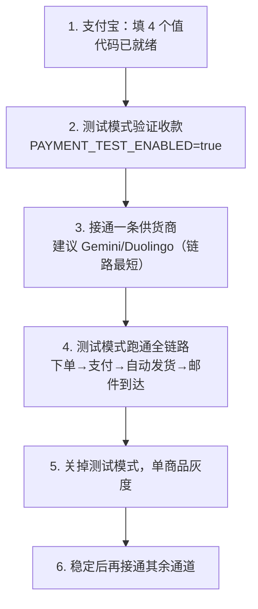

# 接入渠道清单

> 这份文档回答一个问题：**要让商品从「暂停售卖」变成「可以下单」，具体缺什么、在哪填、怎么验。**
>
> 面向：本项目维护者 / 二次开发者。

---

## 一、结论先行

| 通道 | 代码状态 | 你需要做的 |
|---|---|---|
| **支付宝直连** | ✅ **完整真实实现**（官方网关 + RSA2 签名 + 回调验签） | **只要填 4 个值** |
| **聚合支付 A / B** | ⚠️ 签名逻辑完整，**主机名被替换成保留域名** | 换回真实主机 + 核对字段 |
| **充值（ChatGPT 系列）** | ⚠️ 约 2400 行逻辑完整，**端点被匿名化** | 换回真实端点 + 核对签名串 |
| **邮件交付供货商**（Gemini / Duolingo） | ⚠️ **框架与协议已实现**（`DeliverySupplier`），商品映射在 `mappings` | 换上游只需改 `mappings` 和 `DELIVERY_SUPPLIER_API_BASE` |
| **账号供货商**（Gmail） | ❌ **仅框架** | 按上游文档实现 |
| **X 赠送**（X Premium） | ❌ **仅框架** | 按上游文档实现 |

**换句话说：收款这一半几乎是现成的 ✅，发货这一半需要按上游协议补 ❌。**

---

## 二、商品能不能卖，由这段代码决定

`internal/procurement/service.go`：

```go
func (s *Service) Enabled(plan string) bool {
    // 三道公共门槛，缺一不可
    if !s.EmailEnabled || !s.PaymentReady || s.Delivery.Sender == nil {
        return false
    }
    switch Kind(plan) {
    case "gmail":               // gmail-account
        return s.GmailEnabled && s.AccountSupplier != nil && s.GoodsID > 0 && s.MaxCents > 0
    case "delivery_supplier":   // gemini-pro-18m, duolingo-12m
        return s.NYEnabled && s.DeliverySupplier != nil && s.FX > 0 && s.FX <= 100
    }
    return false
}
```

**注意：`enabled` 不是数据库里的标志位。** 你在后台把套餐设成「启用」只是前提，**真正决定它能不能卖的是上面这段逻辑**。所以「后台显示启用、前台显示暂停售卖」是正常的，不是 bug。

### 三道公共门槛分别是什么

| 门槛 | 来源 | 怎么满足 |
|---|---|---|
| `EmailEnabled` | `EMAIL_PRODUCTS_ENABLED` | 设为 `true`（**最容易漏的一项**） |
| `PaymentReady` | 见下 | 配好支付通道 + 打开结账开关 + 通知域名 |
| `Delivery.Sender` | 邮件服务 | 已配好（Resend） |

`PaymentReady` 的完整条件（`internal/httpapi/server.go`）：

```go
pc.PaymentReady = opts.Payments != nil &&
                  opts.Payments.Provider != nil &&   // 至少一个支付通道可用
                  opts.Payments.Checkout &&          // PAYMENT_CHECKOUT_ENABLED=true
                  opts.Payments.NotifyOrigin != ""   // PAYMENT_NOTIFY_ORIGIN 必填
```

---

## 三、套餐 → 通道 依赖表

| 套餐 ID | 商品 | 依赖的通道 | 对应环境变量前缀 |
|---|---|---|---|
| `plus` / `pro-5x` / `pro-20x` / `pro-25x` | ChatGPT | **充值** | `RECHARGE_*` |
| `codex-sms-once` | Codex 接码 | **充值** | `RECHARGE_*` |
| `gemini-pro-18m` | Gemini Pro | **邮件交付供货商** | `DELIVERY_SUPPLIER_*` |
| `duolingo-12m` | Duolingo | **邮件交付供货商** | `DELIVERY_SUPPLIER_*` |
| `gmail-account` | Gmail 账号 | **账号供货商** | `ACCOUNT_SUPPLIER_*` |
| `x-premium-3m` / `x-premium-6m` | X Premium | **X 赠送** | `XGIFT_*` / `XGIFT_PLATFORM_*` |
| 全部 | — | **支付** | `ALIPAY_*` 或 `GATEWAYA_*` / `GATEWAYB_*` |

> **一个容易踩的坑**：充值通道缺位时，`/api/catalog` 会先把**所有**套餐置为不可售（`plans[i].Enabled = 0`），
> 之后**只有**带供货商的套餐（`procurement.Kind(plan) != ""`）会被各自的通道重新开启。
> 结果就是 **ChatGPT 系列单独依赖充值通道** —— 不接充值，它们永远不会变成可售，哪怕你在后台把套餐设成「启用」。

**建议：先接通一行，别一次全上。** Gemini / Duolingo 那条链路最短（纯邮件交付），最适合当第一条。

---

## 四、逐个通道：填什么、缺什么

所有变量名以 `.env.integrations.example` 为准，复制成 `.env.integrations` 后叠加：

```sh
cp .env.integrations.example .env.integrations
# 然后把已经接通的通道设为 enabled=true
```

### 1. 支付宝直连（✅ 只缺密钥）

```ini
ALIPAY_ENABLED=true
ALIPAY_APP_ID=你的应用ID
ALIPAY_SELLER_ID=你的商户UID
# 密钥用文件挂载，别写进环境变量
ALIPAY_APP_PRIVATE_KEY_FILE=/run/integrations/alipay-private
ALIPAY_PUBLIC_KEY_FILE=/run/integrations/alipay-public
PAYMENT_CHECKOUT_ENABLED=true
PAYMENT_NOTIFY_ORIGIN=https://shop.example.invalid
```

- 代码会**拒绝**非官方网关（防 SSRF），沙箱也是白名单内的
- 签名算法 RSA2 / SHA256，回调验签、幂等、金额校验都实现了
- `PAYMENT_NOTIFY_ORIGIN` 是异步通知的对外地址，必须是**公网可达**的正式域名

### 2. 充值通道（ChatGPT 系列）

```ini
RECHARGE_ENABLED=true
RECHARGE_CHECKOUT_ENABLED=true
RECHARGE_API_BASE=https://上游真实地址
RECHARGE_PARTNER_ID=
RECHARGE_KEY_ID=
RECHARGE_CLIENT_SECRET_FILE=/run/integrations/recharge-client
RECHARGE_PRODUCT_MAP={}          # 套餐 → 上游商品ID 的映射
RECHARGE_NOTIFY_URL=
RECHARGE_WEBHOOK_SECRET_FILE=/run/integrations/recharge-webhook
RECHARGE_COLLECTION_MODE=platform_collect
```

**要做的事**：`internal/recharge/client.go` 里的主机名是保留域名，换成真实地址；`RECHARGE_PRODUCT_MAP` 填你上游的商品对应关系。

### 3. 邮件交付供货商（Gemini / Duolingo）

```ini
EMAIL_PRODUCTS_ENABLED=true
DELIVERY_SUPPLIER_ENABLED=true
DELIVERY_SUPPLIER_CHECKOUT_ENABLED=true
DELIVERY_SUPPLIER_API_KEY_FILE=/run/integrations/delivery_supplier
DELIVERY_SUPPLIER_CNY_PER_USD=6.7      # 汇率，用于把上游美元报价换算成人民币
```

**要做的事**（`internal/procurement/clients.go`）：

```go
const geminiService = "S_09" // 18-month Gemini; S_01 is a seven-day service

var mappings = map[string]struct{ ID string; Ceiling int64 }{
    "gemini-pro-18m": {geminiService, 60},
    "duolingo-12m":   {"S_03", 60},
}
```

- `ID` = 上游的商品编号，必须真实存在于 `GET /products` 的 `services[].service_id`
- `Ceiling` = 你愿意支付的**成本上限**（美分）。代码会用它和你后台设的售价比对，**成本高于售价会拒绝下单**（防止亏本卖）

**订单响应有两种形状，适配器都接受。** 上游可能返回完整对账字段：

```json
{"order":{"order_id":"…","requested_quantity":1,"order_status":"success","charged_amount":0.5,"refunded_amount":0,"net_charged_amount":0.5,"delivered_quantity":1,"partial_delivery":false,"delivered_products":["…"]}}
```

也可能只返回短字段，没有退款、净额、交付数量这些计数器：

```json
{"order":{"order_id":"…","service_id":"S_03","quantity":1,"amount":0.5,"status":"success","delivered_products":["…"]}}
```

短字段情况下，`success` + 扣款额 + 交付值数量就是完成凭证：退款与部分交付在上游语义里必然表现为别的 `status`。若 `status` 为 `refunded` 但缺少退款计数器，系统**保持 pending 而不判失败** —— 扣款可能还没退回，误判会让客户钱货两空。

### 4. 账号供货商（Gmail）

```ini
ACCOUNT_SUPPLIER_ENABLED=true
ACCOUNT_SUPPLIER_CHECKOUT_ENABLED=true
ACCOUNT_SUPPLIER_API_BASE=https://上游真实地址
ACCOUNT_SUPPLIER_APP_ID=
ACCOUNT_SUPPLIER_APP_SECRET_FILE=/run/integrations/account_supplier
ACCOUNT_SUPPLIER_GOODS_ID=            # 上游商品编号
ACCOUNT_SUPPLIER_MAX_COST_CENTS=      # 采购成本上限（分）
```

### 5. X 赠送（X Premium）

```ini
XGIFT_ENABLED=true
XGIFT_CHECKOUT_ENABLED=true
XGIFT_BACKEND=legacy            # 或 platform
XGIFT_API_BASE=
XGIFT_USER_ID=
XGIFT_KEY_ID=
XGIFT_CLIENT_SECRET_FILE=/run/integrations/xgift-legacy
```

### 6. 可选：聚合支付 / 会话预检 / Telegram

```ini
GATEWAYA_ENABLED= / GATEWAYB_ENABLED=     # 备选支付通道
SESSION_PRECHECK_ENABLED=                 # 下单前会话预检（如果你上游需要）
TELEGRAM_ENABLED=                         # 订单通知到 Telegram
```

`GATEWAYB` 就是**易支付 v1 / MD5 单签**协议（ZPay 等聚合支付都按这套）：`/mapi.php` 下单、`/api.php?act=order` 查单、`/api.php?act=refund` 退款、GET 回调验签。需要三个值：

```ini
GATEWAYB_ENABLED=true
GATEWAYB_API_BASE=https://网关根地址      # 只写到域名，不带尾部斜杠；真实值只放节点
GATEWAYB_PID=商户ID
GATEWAYB_KEY_FILE=/run/integrations/gatewayb-key
```

`cid` 不填就用商户默认渠道；回调地址由 `PAYMENT_NOTIFY_ORIGIN` + `/api/payments/notify/gatewayb-{alipay|wxpay}` 拼出，必须是公网 https。渠道开通后还要在后台把 `payment_settings` 的 `enabled_providers` 打开，否则收银台不显示。

---

### 7. canboso（Telegram 买家 API · 账号交付）

```ini
CANBOSO_ENABLED=true
CANBOSO_CHECKOUT_ENABLED=true
CANBOSO_API_BASE=https://canboso.com
CANBOSO_KEY_FILE=/run/integrations/canboso-key
CANBOSO_CNY_PER_USD=6.7
```

- 只有**即时账号交付**能自动发卡：采购响应必须 `status=completed` 且带 `delivery.accounts[]`。`slot` / `upgrade_account` 由上游人工履约，响应里没有凭据，不要映射。
- 套餐 → 商品号与美元成本上限写死在 `internal/procurement/service.go` 的 `canbosoMappings`（`plus` → `6ad8a9470c1a1b0e66502c1c` 987¢，`gmail-account` → `6ad90b1b0c1a1b0e66654295` 96¢）。
- 采购必须带 `Idempotency-Key`；代码用 `cbx_<订单号>`，重试不会重复扣款。写入过一次之后只读，不再二次下单。
- 钱包是美元余额，必须先充值。余额不足的 400 会被识别成 `ErrCanbosoBalance` 并直接拒单。
- 商品列表响应约 400 KB，超过其它供应商的 256 KB 上限，canboso 用自己的 4 MB 边界。
- `gmail-account` / `plus` 的通道随配置切换：配了 canboso 就走 canboso，否则 `gmail-account` 仍回到旧的 `ACCOUNT_SUPPLIER_*`。
- 交付值渲染成单行（`账号  密码：…  验证邮箱：…`）：`delivery.ValidValue` 拒绝控制字符，不能换行。

---

## 五、接入顺序（建议）



**每一层不要跳步。** 特别是第 2 步：支付宝有沙箱和测试模式，先用它们确认「能收到钱、回调能验签、订单状态能流转」，再去碰供货商。

### 测试模式相关开关

```ini
ORDER_TESTING_ENABLED=true    # 下单不产生真实交易
PAYMENT_TEST_ENABLED=true     # 支付走联调，不真扣钱
```

上线前**必须**都改回 `false`。

---

## 六、验收清单

每接通一条通道，按这个清单验证一遍：

- [ ] `/api/catalog` 里该商品的 `enabled` 变成 `1`
- [ ] 前台卡片不再显示「暂停售卖」
- [ ] 能进到支付页，金额与后台售价一致
- [ ] 支付成功后订单变成 `success`
- [ ] **自动发货真的发生了**（供货商侧能查到那笔采购）
- [ ] 客户收到交付邮件（`/var/log` 或 Resend 后台能看到）
- [ ] 后台订单页能看到完整流水
- [ ] 退款路径能走通（会调 `alipay.trade.refund`）
- [ ] 成本 ≤ 售价（`Ceiling` 配置正确，不会亏本）
- [ ] 关掉对应开关后，商品立刻回到「暂停售卖」

### 服务端自查命令

```sh
cd /opt/anx/services/storefront
docker compose logs -f --tail=50 api          # 实时日志
curl -sS http://127.0.0.1:8093/healthz        # 健康检查
docker compose config | grep -E 'ENABLED|ORIGIN'   # 确认开关真的生效了
```

---

## 七、代码从哪来

**不要从零写。** 这些适配器的完整版本存在于本项目的**原始实现**里，开源版只是把它们匿名化了。两条路：

1. **从原始项目取回**（推荐）—— 把对应文件覆盖回来，对照 `example.invalid` 出现的位置逐个替换。定位方法：

   ```sh
   grep -rn "example\.invalid" internal/
   ```

   每一处都是需要你补的真实地址或标识。

2. **按上游文档实现** —— 框架、签名封装、响应校验、错误分类都已经写好了（`internal/procurement/clients.go` 里有现成的 `client()` / `readResponse()` / `cents()` 等工具），你主要是在此基础上填协议细节。

### 安全约束（实现时不要绕过）

- 供应商响应**有大小上限**（256KB）和 UTF-8 校验，别放宽
- 金额一律用**整数分**或 `big.Rat` 精确比较，不要用浮点
- 回调必须**验签 + 去重 + 金额核对**，这三样都已在回调路径里
- 支付宝网关有白名单校验，不要改成可配置的任意 URL（那是 SSRF）
- 密钥一律走 `*_FILE` 挂载，不要写进环境变量或提交进仓库

---

## 八、和「运维」的分界

| 事项 | 归属 |
|---|---|
| 服务器、HTTPS、备份、监控、部署 | 已完成，见 `/opt/anx/OPS.md` |
| 支付 / 供货商适配器 | **本文档，需要你的上游凭据和协议** |
| 打开结账开关 | 通道就位后一条命令，但要**先验证**再开 |
